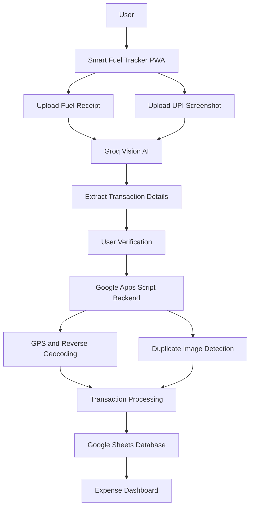
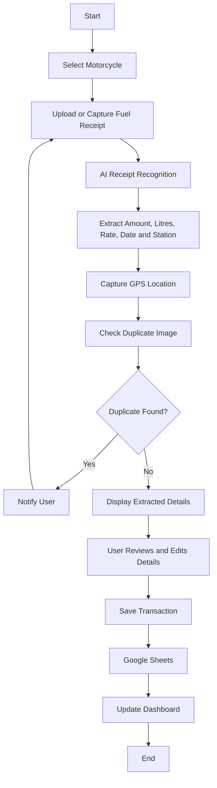
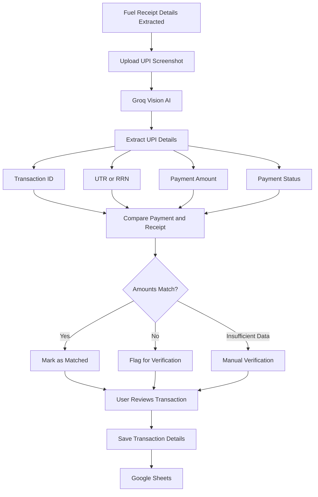
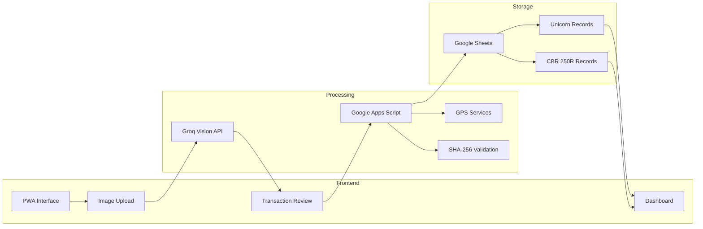

# Smart Fuel Tracker

## 1. Project Overview

Smart Fuel Tracker is a personal motorcycle fuel management system developed to simplify the process of recording, organizing and analysing fuel expenses.

The project is designed around two motorcycles: Honda Unicorn and Honda CBR 250R.

Its primary objective is to eliminate repetitive manual fuel entry by using AI-powered image extraction to identify transaction details from petrol receipts and UPI payment screenshots.

The system combines artificial intelligence, GPS-based location services, automation and cloud-based data storage to maintain an organized record of every refuelling activity.

## 2. Project Concept

Whenever fuel is purchased, instead of manually entering transaction details, the user can capture or upload a photograph of the petrol receipt.

The application uses Groq Vision to analyse the receipt and extract relevant information. A separate UPI screenshot can also be uploaded to identify payment information and compare it against the receipt.

The extracted information is presented to the user for verification and correction before being saved to Google Sheets.

The system maintains separate records for each motorcycle and provides a consolidated dashboard for monitoring fuel expenditure.

## 3. System Architecture

The application connects the frontend, AI extraction service, location services, backend and Google Sheets.

## 4. Fuel Transaction Workflow

This workflow explains how a fuel purchase is recorded, from image upload to final database entry.

## 5. UPI Payment Verification Workflow

The system supports a separate UPI screenshot to identify payment information and compare it with the fuel receipt.

## 6. Core Functionalities

### 6.1 AI-Based Fuel Receipt Recognition

Uses Groq Vision to analyse petrol receipt images and extract:

- Petrol station name
- Transaction date and time
- Fuel quantity in litres
- Total amount paid
- Price per litre

### 6.2 UPI Payment Recognition

Processes separate UPI payment screenshots to identify visible payment information:

- UPI transaction ID
- UTR/RRN
- Payment amount
- Payment date and time
- Payment status
- UPI application

### 6.3 Transaction Verification

Compares the extracted fuel receipt amount with the UPI payment amount to help identify matching or mismatching transactions.

### 6.4 GPS-Based Location Identification

Uses the device's GPS location to identify the approximate petrol station location and surrounding area through reverse geocoding.

### 6.5 Motorcycle-Wise Expense Management

Maintains separate fuel records for:

- Honda Unicorn
- Honda CBR 250R

### 6.6 Duplicate Image Detection

Uses SHA-256 image hashing to identify previously submitted fuel receipt images and reduce duplicate transaction entries.

### 6.7 Expense Dashboard

Provides an overview of:

- Total fuel expenditure
- Total litres purchased
- Average fuel price per litre
- Individual motorcycle expenses
- Overall fuel consumption records

### 6.8 Editable Transaction Records

AI-extracted information is not automatically treated as final. The user can review and correct transaction details, including date and time, before saving.

## 7. Technology Stack

| Component | Technology |
|---|---|
| User Interface | HTML, CSS, JavaScript |
| Backend | Google Apps Script |
| Data Storage | Google Sheets |
| AI Image Extraction | Groq Vision API |
| Location Services | Browser Geolocation API |
| Reverse Geocoding | OpenStreetMap Nominatim |
| Duplicate Detection | SHA-256 |
| Application Format | Progressive Web App |
| Hosting | GitHub Pages |

## 8. Data Organization

The system maintains separate worksheets for the two motorcycles.

### Primary Fuel Transaction Data

| Field | Description |
|---|---|
| Transaction ID | Unique transaction identifier |
| Motorcycle | Selected motorcycle |
| Date and Time | Fuel purchase date and time |
| Station Name | Petrol station identification |
| Area | Approximate location |
| Amount | Total fuel purchase amount |
| Litres | Fuel quantity |
| Rate | Price per litre |
| Source | Transaction data source |
| Confidence | Extraction confidence |
| GPS Status | Location status |
| Image Hash | Duplicate detection identifier |

### UPI Transaction Data

| Field | Description |
|---|---|
| UPI Transaction ID | Extracted transaction identifier |
| UTR/RRN | Payment reference number |
| UPI App | Payment application |
| Payment Status | Extracted payment status |
| Payment Date | Payment date |
| Payment Time | Payment time |
| UPI Amount | Payment amount |
| UPI Match Status | Receipt and payment comparison |
| UPI Image Hash | UPI screenshot hash |

## 9. Application Architecture and Data Flow

The application follows a lightweight architecture in which Google Apps Script acts as the backend and Google Sheets acts as the persistent database.

The PWA handles user interaction, image uploads, transaction review and dashboard presentation.

Groq Vision performs image-based extraction, while GPS and reverse geocoding provide location context.

## 10. Project Objective

The objective is to build a lightweight personal fuel management system that reduces manual data entry, improves transaction organization and provides a clearer understanding of motorcycle fuel expenditure over time.

Rather than maintaining separate notes or manually updating spreadsheets after every refuelling activity, the system brings receipt recognition, payment verification, location identification and expense tracking into one workflow.

## 11. Future Improvements

- Fuel efficiency and mileage calculations.
- Monthly and yearly expense analytics.
- Fuel price trend analysis.
- Service and maintenance expense tracking.
- Advanced ride and fuel consumption reports.
- Exportable expense reports.
- Historical fuel station comparisons.

## 12. Personal Project

Developed as a personal technology project to explore practical applications of AI vision, automation, GPS integration and cloud-based data management.

**Core idea:** Turning everyday motorcycle refuelling transactions into structured, searchable and analysable data with minimal manual effort.
